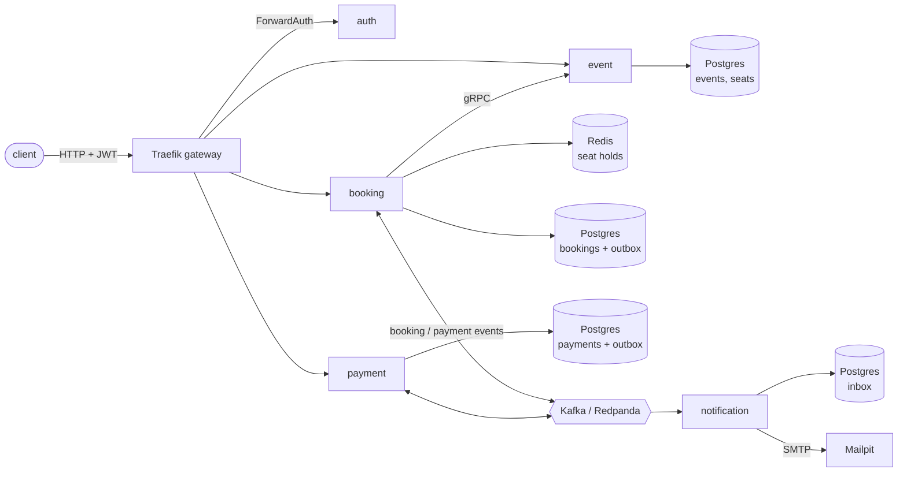

# ticketing

An event ticketing platform built as Go microservices. Customers hold seats,
book them, and pay; many customers race for the same seats, services fail and
recover, and no seat is ever sold twice.

The project is about the hard parts of distributed systems, done the way the
Go community writes services:

- **Concurrency-safe seat reservation:** atomic all-or-nothing holds in Redis
  (Lua), and a Postgres unique index as the final guard.
- **A payment saga over Kafka:** choreographed, with a transactional outbox,
  an inbox, retries, dead-letter topics, a timeout and a compensating refund.
- **Idempotency end to end:** retried requests and redelivered messages never
  book, charge or email twice.
- **Security at the edge:** a Traefik gateway, Ed25519 JWTs, ForwardAuth,
  roles and rate limits.
- **Observability:** OpenTelemetry traces that follow a request across HTTP,
  gRPC and Kafka, RED and business metrics, correlated logs, dashboards and alerts.

Load-tested with k6: 200 concurrent customers on 200 seats, 0 server errors,
**0 seats sold twice** ([results and bottleneck analysis](docs/load-test.md)).

## Quick start

Prerequisites: Docker with Compose v2, Make, Go 1.26+ (only for running tests
locally), and `bash` (Git Bash on Windows).

```bash
make services-up   # builds 5 services, starts ~20 containers, waits until all are healthy
make demo          # guided tour: login, roles, holds, booking, saga, declined card
```

| What | URL |
|---|---|
| **API gateway** (every API call) | http://localhost:8000 |
| Grafana: dashboards, traces, logs | http://localhost:3000 |
| Mailpit: emails sent to customers | http://localhost:8025 |
| Redpanda Console: Kafka topics and messages | http://localhost:8085 |
| Traefik dashboard: routes and middlewares | http://localhost:8090 |
| Prometheus: metrics and alerts | http://localhost:9090 |

`make` lists every target. `make services-down` stops everything.

## Architecture



| Service | Responsibility | Storage | Talks via |
|---|---|---|---|
| `auth` | Login, Ed25519 JWTs, JWKS, ForwardAuth for the gateway | — | HTTP |
| `event` | Events, venues, seat catalog | Postgres | HTTP (public), gRPC (internal) |
| `booking` | Seat holds, bookings, saga steps, payment timeout | Postgres, Redis | HTTP, gRPC client, Kafka |
| `payment` | Charges and refunds through a mock provider | Postgres | Kafka, HTTP (read-only) |
| `notification` | Emails on confirmation, cancellation, refund | Postgres (inbox) | Kafka, SMTP |

Each service owns its database. Services talk synchronously only where an
answer is needed right away (booking asks the catalog for seat prices over
gRPC) and asynchronously everywhere else.

### Life of a booking

1. The customer **holds** seats: booking asks event (gRPC) for prices, checks
   Postgres for sold seats, then a Lua script in Redis locks every seat or none,
   with a TTL.
2. The customer **books** the hold: booking writes the booking and a
   `BookingCreated` event into its outbox **in one transaction**. A unique index
   makes it impossible for a seat to be in two active bookings.
3. The outbox relay publishes to Kafka. **Payment** charges the customer (with an
   idempotency key) and publishes `PaymentSucceeded` or `PaymentFailed`.
4. Booking **confirms** the booking, or **cancels** it and frees the seats.
   Unpaid bookings are cancelled after `PAYMENT_TIMEOUT`; a payment that arrives
   for a cancelled booking is **refunded** (compensation).
5. **Notification** emails the customer, exactly once per event (inbox).

The whole chain, minutes apart if a service was down, shows up as **one trace**
in Grafana.

## Design decisions

Every significant choice has an Architecture Decision Record:

| ADR | Decision |
|---|---|
| [1](docs/adr/0001-record-architecture-decisions.md) | Record architecture decisions |
| [2](docs/adr/0002-monorepo-single-go-module.md) | Monorepo with a single Go module; `internal/` keeps services apart |
| [3](docs/adr/0003-hand-written-sql-with-pgx.md) | Hand-written SQL with pgx, embedded goose migrations |
| [4](docs/adr/0004-observability-with-opentelemetry.md) | OpenTelemetry for traces, metrics and logs; one collector |
| [5](docs/adr/0005-seat-holds-in-redis-bookings-in-postgres.md) | Seat holds in Redis, bookings guarded by a Postgres unique index |
| [6](docs/adr/0006-payment-saga-with-outbox-and-kafka.md) | Choreographed payment saga with a transactional outbox |
| [7](docs/adr/0007-gateway-and-authentication.md) | Traefik gateway, ForwardAuth and Ed25519 JWTs |

## Using the API

Everything goes through the gateway. Reading the catalog is public; the rest
needs a bearer token.

```bash
TOKEN=$(curl -s localhost:8000/v1/token -d '{"username":"alice","password":"demo-secret"}' | jq -r .access_token)
curl -H "Authorization: Bearer $TOKEN" localhost:8000/v1/holds \
  -d '{"event_id": "<event id>", "seat_ids": ["<seat id>"]}'
```

| User | Password | Role |
|---|---|---|
| `admin` | `admin-secret` | admin: manages the catalog, reads all payments |
| `alice`, `bob` | `demo-secret` | customer |
| `customer-<anything>` | `demo-secret` | customer, only with `DEMO_SIGNUP=true` (load tests) |

| Method | Path | Who | Description |
|---|---|---|---|
| `POST` | `/v1/token` | anyone | Log in, get a 15-minute JWT |
| `GET` | `/.well-known/jwks.json` | anyone | Public key to verify tokens |
| `GET` | `/v1/events`, `/v1/events/{id}`, `/v1/events/{id}/seats` | anyone | Catalog (keyset pagination: `?limit=&cursor=`) |
| `POST` | `/v1/events`, `/v1/events/{id}/publish`, `/v1/events/{id}/cancel` | admin | Manage events |
| `GET` | `/v1/events/{id}/availability` | customer | Booked and held seats |
| `POST` | `/v1/holds` | customer | Hold seats (all or nothing); `409` lists taken seats |
| `GET`, `DELETE` | `/v1/holds/{id}` | owner | Read or release a hold |
| `POST` | `/v1/bookings` | customer | Book a hold; idempotent (`201` new, `200` retry) |
| `GET` | `/v1/bookings/{id}` | owner | Booking with status and cancel reason |
| `POST` | `/v1/bookings/{id}/cancel` | owner | Cancel an unpaid booking |
| `GET` | `/v1/payments?booking_id=` | owner, admin | Payment of a booking |

Errors are [RFC 9457 problem details](https://www.rfc-editor.org/rfc/rfc9457)
with the request id. Other people's bookings and payments answer `404`, so ids
cannot be probed.

**Try the failure paths:** prices ending in `.13` (e.g. `2513` cents) are
declined; `PROVIDER_FAILURE_RATE` injects transient payment errors (retried);
stopping the payment container shows the timeout and the refund.

## Observability

```
gateway + services ──OTLP──▶ OpenTelemetry Collector ──▶ Tempo       traces
                                                    ├──▶ Prometheus  metrics + alerts
                                                    └──▶ Loki        logs
                                         Grafana reads all three, linked by trace id
```

- **Traces** start at the gateway and follow the request through ForwardAuth,
  the services, gRPC, SQL, Redis and Kafka (the trace context travels in the
  outbox and in record headers).
- **Metrics:** RED metrics per route, business counters (holds by result,
  bookings, payments by outcome, refunds), outbox backlog, consumer and
  dead-letter counts, Postgres pool, Redis and Go runtime. Latency panels
  carry exemplars: click a dot to open that request's trace.
- **Logs:** JSON on stdout and OTLP to Loki, with `trace_id` on every line.
- **Dashboard:** Grafana → Dashboards → Ticketing → *Service overview* (pick a
  service at the top).
- **Alerts** ([alerts.yml](deploy/compose/observability/alerts.yml)): 5xx rate,
  p95 latency, outbox backlog, dead-lettered messages, payment provider errors.

## Testing

```bash
make test              # unit tests (race detector when a C compiler is available)
make test-integration  # + adapter tests against real Postgres and Redis (testcontainers)
make lint              # golangci-lint v2 with a strict configuration
make vuln              # govulncheck
make load-test         # k6 flash sale through the gateway + database check for double bookings
```

What the tests prove, beyond the happy path:

- 50 goroutines racing for overlapping seats in Redis: no seat has two owners.
- 20 concurrent bookings of one seat in Postgres: exactly one succeeds.
- Ten concurrent publishes of one event: the row lock lets one through.
- A rolled-back transaction leaves no outbox event behind.
- Redelivered messages charge once, confirm once, email once.
- Forged, expired, foreign-key, wrong-audience and `alg: none` tokens are rejected.

CI ([ci.yml](.github/workflows/ci.yml)) runs lint, unit and integration tests
with `-race`, govulncheck, buf lint and breaking-change detection, compose,
alert-rule and dashboard validation, and builds every image.

## Repository layout

```
api/proto/            protobuf contracts: gRPC catalog API and Kafka event schemas (buf)
api/gen/              generated Go code (committed)
services/<name>/      one service: cmd/ (main), internal/{domain,app,adapter,transport,config}
pkg/                  shared infrastructure: httpx, grpcx, kafkax, outbox, messaging,
                      telemetry, logger, postgres, redisx, bootstrap
deploy/compose/       infrastructure, observability and services; gateway and Grafana config
scripts/              demo.sh, k6 load test
docs/                 ADRs, load test report
```

Inside a service, dependencies point inwards: `domain` has no infrastructure
imports, `app` defines the interfaces it needs (ports) and `adapter` implements
them; `transport` translates HTTP, gRPC and Kafka into use cases.

## What I would do next

- Kubernetes manifests (Helm or Kustomize) with network policies instead of
  "no host ports", and horizontal autoscaling of booking and event.
- Tail sampling in the collector, and moving the observability stack off the
  application hosts (see the [load test analysis](docs/load-test.md)).
- A real identity provider (OIDC) instead of the configuration-backed users,
  and refresh tokens.
- An orchestrated saga (state machine) if the booking flow gains more steps.
